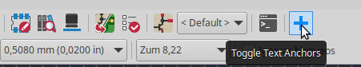

# KiCad Text Anchors Overlay

A lightweight KiCad PCB Editor plugin that toggles anchor crosses on the `User.Comments` layer for PCB texts and footprint fields.

## Features
- **One-click toggle**: From the PCB Editor toolbar or `Tools > External Plugins > Toggle Text Anchors`.
- **Multi-layer support**: Tracks texts across any board layer (`F.Silkscreen`, `B.Silkscreen`, `F.Cu`, etc.).
- **Real-time tracking & clean toggle**: Updates crosses dynamically and removes them cleanly when toggled off.

## Installation
- **Option 1 (Recommended):** Install via KiCad **Plugin and Content Manager** using the `.zip` from [Releases](../../releases).
- **Option 2 (Manual):** Copy `plugins/` into your KiCad 3rd-party plugins directory (`~/.local/share/kicad/10.0/3rdparty/plugins/...` on Linux, etc.).

## License
Distributed under the MIT License. See `LICENSE` for details.
